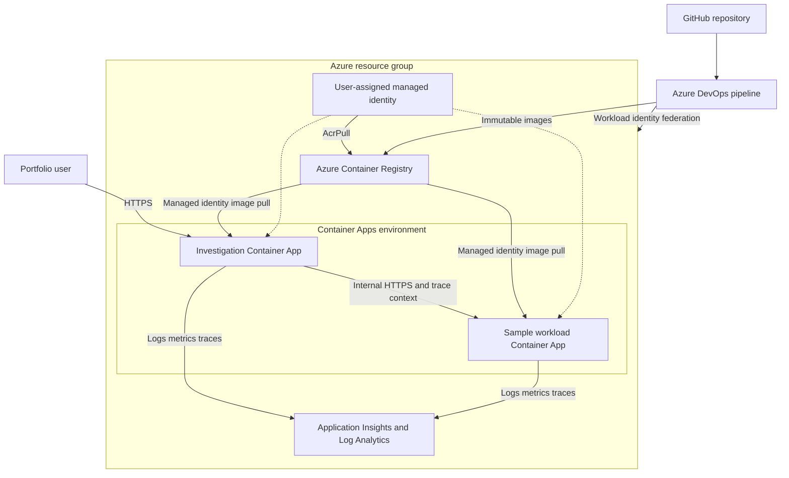
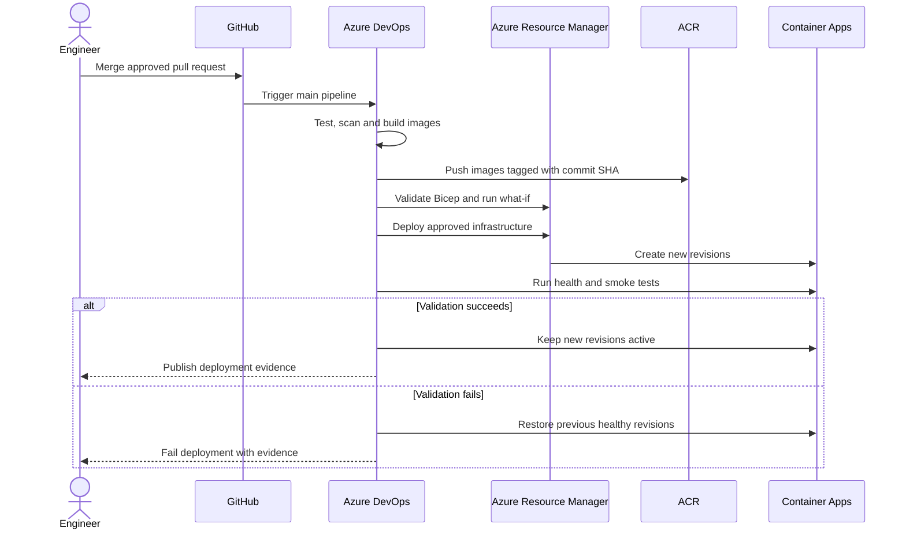

# ADR 0002: Deploy StackLoom on Azure Container Apps

- **Status:** Proposed for Milestone 2
- **Date:** 2026-11-12
- **Jira:** JIRA-0002
- **Decision owners:** StackLoom Labs
- **Supersedes:** None
- **Related:** ADR 0001 — Establish a reproducible investigation baseline

## Context

Milestone 1 provides a deterministic FastAPI incident lab with synthetic scenarios, curated runbooks, automated tests, a non-root container, and a validated Azure DevOps CI pipeline. It does not deploy to Azure or collect telemetry from a real distributed workload.

Milestone 2 needs a small Azure environment that demonstrates reproducible infrastructure, immutable application delivery, service-to-service failure scenarios, and traceable operational evidence. The environment is a portfolio lab rather than a production service. It must minimize standing cost and operational burden while preserving a credible path to later AI-assisted investigation.

## Decision drivers

- Reproducible deployment and teardown through infrastructure as code.
- Low idle cost for a personal engineering lab.
- Native container revisions, health probes, and rollback support.
- Clear separation between the sample workload and investigation service.
- Least-privilege, secretless authentication for pipelines and image pulls.
- Real logs, metrics, and distributed traces with run correlation.
- Immutable promotion of the same tested image.
- Explicit gates before AI, MCP, or remediation capabilities are introduced.

## Decision

Deploy two Python container applications into one Azure Container Apps environment:

1. **Investigation service** — exposes the browser experience and investigation API through external HTTPS ingress.
2. **Sample service** — provides controlled healthy and failing endpoints through internal ingress and generates real telemetry for investigation.

Store versioned images in Azure Container Registry. Provision Azure resources with modular Bicep. Azure DevOps will authenticate to Azure using workload identity federation, build and push commit-tagged images, run a Bicep what-if, deploy the infrastructure, update the Container Apps revisions, and execute health and smoke tests.

Use a user-assigned managed identity with `AcrPull` for container image retrieval. Grant the pipeline identity only the resource-group deployment and registry push permissions it needs. Do not use registry admin credentials, client secrets, or passwords in source control or pipeline YAML.

Use workspace-based Application Insights and Log Analytics. Instrument both services with OpenTelemetry and propagate a correlation ID across service calls. Retain the deterministic rules and abstention behavior from Milestone 1; real telemetry becomes an additional evidence source rather than permission to overstate causality.

## Target architecture



## Deployment and verification flow



## Resource model

| Resource | Initial configuration | Purpose |
|---|---|---|
| Resource group | One `dev` resource group | Ownership, RBAC, cost and teardown boundary |
| Container Apps environment | Consumption workload profile | Shared runtime and internal service discovery |
| Investigation Container App | External ingress, port 8000, min 0, max 1 | Browser UI and investigation API |
| Sample Container App | Internal ingress, port 8000, min 0, max 1 | Controlled workload and failure generation |
| Azure Container Registry | Basic SKU | Private immutable image storage |
| User-assigned managed identity | Shared for image pull initially | Secretless `AcrPull` access |
| Log Analytics workspace | Short lab-appropriate retention | Platform and application log storage |
| Application Insights | Workspace based | Traces, dependencies, requests and failures |
| Budget and alerts | Monthly lab ceiling with staged alerts | Cost visibility and guardrails |

Names, subscription, Azure region, budget ceiling, and retention period remain deployment parameters. The preferred starting region is Canada Central, subject to subscription support and service availability.

## Infrastructure layout

Use Bicep modules so identity and policy decisions remain reviewable:

```text
infra/
  main.bicep
  main.dev.bicepparam
  modules/
    registry.bicep
    identity.bicep
    observability.bicep
    container-apps-environment.bicep
    container-app.bicep
    role-assignments.bicep
```

Do not store subscription IDs, tenant IDs, connection strings, or generated resource identifiers in committed parameter files when they can be supplied by the service connection or Bicep outputs.

## Delivery controls

- Trigger CI for pull requests and `main`; deploy only from approved `main` builds.
- Build each container once and tag it with the full Git commit SHA. A build ID may be added as a secondary tag. Do not deploy `latest`.
- Publish test and deployment evidence from Azure DevOps.
- Validate and lint Bicep before deployment, then run `what-if` for reviewable changes.
- Use an Azure DevOps environment for deployment history and an approval gate before any environment beyond `dev`.
- Verify `/health` and representative API scenarios after deployment.
- Keep the previous healthy Container Apps revision until smoke tests succeed.
- Roll back by shifting traffic to the previous healthy revision; investigate before retrying.
- Prevent concurrent deployments to the same environment.

## Identity and security

- Use an Azure Resource Manager service connection backed by workload identity federation.
- Scope the deployment identity to the StackLoom resource group wherever feasible.
- Grant `AcrPush` to the pipeline identity at the registry scope.
- Grant `AcrPull` to the runtime managed identity at the registry scope.
- Give the investigation service read-only monitoring access only when telemetry querying is implemented.
- Use HTTPS ingress and internal-only ingress for the sample service.
- Treat telemetry, exception messages, and logs as untrusted input.
- Do not introduce public user authentication, model credentials, MCP write tools, or remediation permissions in this milestone.

## Observability

Both services will emit structured logs, request metrics, dependency spans, exceptions, release version, environment, scenario, and a run correlation identifier. Health checks must remain separate from intentionally failing sample endpoints. Dashboards should distinguish platform health from simulated incident outcomes.

The first telemetry acceptance test will prove that one request can be followed from the investigation service to the sample service and back using a shared trace or correlation identifier.

## Cost and lifecycle controls

- Use Container Apps consumption with zero minimum replicas for both services.
- Start with one maximum replica per service.
- Use ACR Basic and one shared observability workspace.
- Configure a monthly Azure budget and multiple alert thresholds before deployment.
- Apply consistent `project`, `environment`, `owner`, and `costCenter` tags.
- Provide a teardown pipeline or documented Bicep/CLI procedure for removing the complete lab resource group.
- Review telemetry retention and ingestion after the first week of use.

## Alternatives considered

### Azure App Service for Containers

App Service is familiar and provides deployment slots, but the initial architecture needs two small containerized services, internal service-to-service communication, revision management, and scale-to-zero economics. Container Apps is a better fit for this lab.

### Azure Kubernetes Service

AKS offers maximum control and broad Kubernetes experience, but it adds cluster cost and operational complexity that do not improve the Milestone 2 learning objective.

### Azure Functions

Functions could reduce cost for event-driven operations, but the current FastAPI application and browser interaction map more directly to long-running HTTP containers. Functions remain an option for later scheduled evaluation or event processing.

### Single Container App

Deploying the existing combined service would be the fastest route, but it would not create a real dependency boundary or distributed trace. The selected two-service design better demonstrates incident telemetry and architectural separation. The code must therefore be split before deployment.

### Registry credentials

ACR admin credentials are simpler to configure but introduce long-lived secrets. Managed identity and workload identity federation are selected instead.

## Consequences

### Positive

- The Azure environment is reproducible and can be removed cleanly.
- Two services create a credible dependency boundary for incident scenarios.
- Secretless authentication reduces credential-management risk.
- Immutable tags and retained revisions improve traceability and rollback.
- Real telemetry prepares the project for evidence-grounded AI evaluation.

### Negative

- Splitting the current application adds implementation work before deployment.
- Scale-to-zero can introduce cold-start latency during demonstrations.
- Application Insights and Log Analytics may become the largest recurring cost if telemetry volume is not controlled.
- Role-assignment creation may require elevated Azure permissions during initial provisioning.

## Risks and mitigations

| Risk | Mitigation |
|---|---|
| Unexpected Azure cost | Budget alerts, min replicas 0, max replicas 1, short retention and teardown |
| Excessive telemetry | Sampling, structured events, retention review and ingestion monitoring |
| Deployment identity is over-privileged | Resource-group scope and explicit registry roles |
| Failed revision receives traffic | Health probes, smoke tests and previous-revision retention |
| Cold-start affects demo | Warm-up request before timed demonstrations |
| Synthetic incident affects health monitoring | Separate `/health` from scenario endpoints |
| Evidence is mistaken for confirmed causality | Preserve evidence references, uncertainty labels and abstention |

## Implementation gates

1. Confirm subscription, region, naming prefix, budget ceiling, and retention.
2. Split the sample workload from the investigation service and add contract tests.
3. Add OpenTelemetry instrumentation and correlation propagation locally.
4. Create and validate Bicep modules with `what-if`.
5. Configure workload-identity service connections and least-privilege roles.
6. Build the deployment pipeline and deploy `dev`.
7. Prove health, smoke, trace correlation, rollback, cost alerts, and teardown.
8. Record actual results before accepting this ADR as implemented.

## Deferred decisions

- Azure OpenAI model, region, quota, token limits, and evaluation dataset.
- MCP server transport, authentication, and read-only tool contracts.
- User authentication and authorization.
- Approval-controlled remediation.
- Additional environments, custom domains, private networking, and disaster recovery.

These items require separate ADRs after the telemetry foundation is validated.
